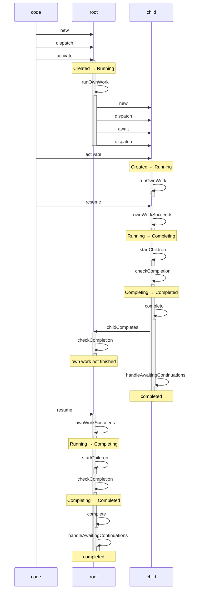
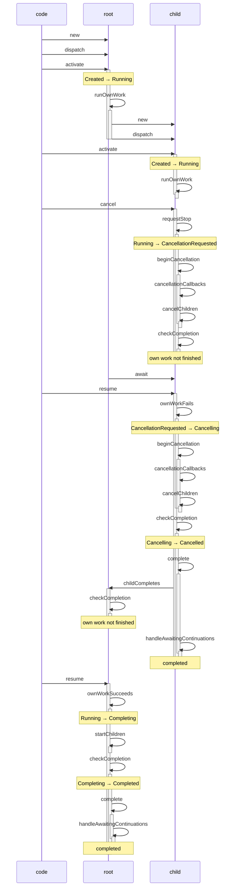

# Task lifecycles

Sequence diagrams of the lifecycle method calls of hxcoro tasks, recorded with `-D hxcoro.trace_tasks` and rendered by this example. Regenerate this file with `haxe --cwd examples/task-trace build-eval.hxml`.

An arrow is a method call on the target task, from the task whose method is running, or from `code` when none is. A bar is the time a method is active. A note is a state change or the result of a method.

## A child completes

The root creates a child that yields once and returns a value, and awaits it.

## A child is cancelled

The root creates a child that waits for cancellation, cancels it, and awaits it.

## A child fails

Under a supervisor, a parent creates a child that throws, and awaits it. The failure is reported to the parent while the child is still winding down, and the parent's cancellation interrupts the await.

```mermaid
sequenceDiagram
    participant code
    participant T1 as root
    participant T2 as scope of root
    participant T3 as parent
    participant T4 as child
    code->>T1: new
    code->>T1: dispatch
    code->>T1: activate
    activate T1
    Note over T1: Created → Running
    T1->>T1: runOwnWork
    activate T1
    T1->>T2: new
    T1->>T2: activate
    activate T2
    Note over T2: Created → Running
    T2->>T2: runOwnWork
    activate T2
    T2->>T3: new
    T2->>T3: dispatch
    T2->>T3: await
    T2->>T3: dispatch
    deactivate T2
    deactivate T2
    T1->>T2: await
    deactivate T1
    deactivate T1
    code->>T3: activate
    activate T3
    Note over T3: Created → Running
    T3->>T3: runOwnWork
    activate T3
    T3->>T4: new
    T3->>T4: dispatch
    T3->>T4: await
    T3->>T4: dispatch
    deactivate T3
    deactivate T3
    code->>T4: activate
    activate T4
    Note over T4: Created → Running
    T4->>T4: runOwnWork
    activate T4
    deactivate T4
    deactivate T4
    code->>T4: resume
    activate T4
    T4->>T4: ownWorkFails
    activate T4
    T4->>T4: recordFailure: recorded
    T4->>T3: childErrors
    activate T3
    T3->>T3: failWith
    activate T3
    T3->>T3: recordFailure: recorded
    T3->>T2: childErrors
    activate T2
    T2->>T2: childErrors: ignored by the supervisor
    deactivate T2
    T3->>T3: requestStop
    activate T3
    Note over T3: Running → CancellationRequested
    T3->>T3: beginCancellation
    activate T3
    T3->>T3: cancellationCallbacks
    T3->>T3: cancelChildren
    activate T3
    T3->>T4: cancel
    activate T4
    T4->>T4: requestStop
    activate T4
    Note over T4: Running → CancellationRequested
    T4->>T4: beginCancellation
    activate T4
    T4->>T4: cancellationCallbacks
    T4->>T4: cancelChildren
    activate T4
    deactivate T4
    deactivate T4
    T4->>T4: checkCompletion
    activate T4
    Note over T4: own work not finished
    deactivate T4
    deactivate T4
    deactivate T4
    deactivate T3
    deactivate T3
    T3->>T3: checkCompletion
    activate T3
    Note over T3: children left
    deactivate T3
    deactivate T3
    deactivate T3
    deactivate T3
    T4->>T4: recordFailure: kept the earlier failure
    Note over T4: CancellationRequested → Cancelling
    T4->>T4: beginCancellation
    activate T4
    T4->>T4: cancellationCallbacks
    T4->>T4: cancelChildren
    activate T4
    deactivate T4
    deactivate T4
    deactivate T4
    T4->>T4: checkCompletion
    activate T4
    Note over T4: Cancelling → Cancelled
    T4->>T4: complete
    activate T4
    T4->>T3: childCompletes
    activate T3
    T3->>T3: checkCompletion
    activate T3
    Note over T3: own work not finished
    deactivate T3
    deactivate T3
    T4->>T4: handleAwaitingContinuations
    activate T4
    deactivate T4
    deactivate T4
    Note over T4: completed
    deactivate T4
    deactivate T4
    code->>T3: resume
    activate T3
    T3->>T3: ownWorkFails
    activate T3
    Note over T3: CancellationRequested → Cancelling
    T3->>T3: beginCancellation
    activate T3
    T3->>T3: cancellationCallbacks
    T3->>T3: cancelChildren
    activate T3
    deactivate T3
    deactivate T3
    deactivate T3
    T3->>T3: checkCompletion
    activate T3
    Note over T3: Cancelling → Cancelled
    T3->>T3: complete
    activate T3
    T3->>T2: childCompletes
    activate T2
    T2->>T2: checkCompletion
    activate T2
    Note over T2: own work not finished
    deactivate T2
    deactivate T2
    T3->>T3: handleAwaitingContinuations
    activate T3
    deactivate T3
    deactivate T3
    Note over T3: completed
    deactivate T3
    deactivate T3
    code->>T2: resume
    activate T2
    T2->>T2: ownWorkSucceeds
    activate T2
    Note over T2: Running → Completing
    deactivate T2
    T2->>T2: startChildren
    activate T2
    deactivate T2
    T2->>T2: checkCompletion
    activate T2
    Note over T2: Completing → Completed
    T2->>T2: complete
    activate T2
    T2->>T1: childCompletes
    activate T1
    T1->>T1: checkCompletion
    activate T1
    Note over T1: own work not finished
    deactivate T1
    deactivate T1
    T2->>T2: handleAwaitingContinuations
    activate T2
    deactivate T2
    deactivate T2
    Note over T2: completed
    deactivate T2
    deactivate T2
    code->>T1: resume
    activate T1
    T1->>T1: ownWorkSucceeds
    activate T1
    Note over T1: Running → Completing
    deactivate T1
    T1->>T1: startChildren
    activate T1
    deactivate T1
    T1->>T1: checkCompletion
    activate T1
    Note over T1: Completing → Completed
    T1->>T1: complete
    activate T1
    T1->>T1: handleAwaitingContinuations
    activate T1
    deactivate T1
    deactivate T1
    Note over T1: completed
    deactivate T1
    deactivate T1
```

## A NonCancellable cleanup block

A cancelled child runs a cleanup block in a `NonCancellable` scope before it rethrows. The parent's cancellation does not reach the block.

```mermaid
sequenceDiagram
    participant code
    participant T1 as root
    participant T2 as child
    participant T3 as cleanup
    code->>T1: new
    code->>T1: dispatch
    code->>T1: activate
    activate T1
    Note over T1: Created → Running
    T1->>T1: runOwnWork
    activate T1
    T1->>T2: new
    T1->>T2: dispatch
    deactivate T1
    deactivate T1
    code->>T2: activate
    activate T2
    Note over T2: Created → Running
    T2->>T2: runOwnWork
    activate T2
    deactivate T2
    deactivate T2
    code->>T2: cancel
    activate T2
    T2->>T2: requestStop
    activate T2
    Note over T2: Running → CancellationRequested
    T2->>T2: beginCancellation
    activate T2
    T2->>T2: cancellationCallbacks
    T2->>T2: cancelChildren
    activate T2
    deactivate T2
    deactivate T2
    T2->>T2: checkCompletion
    activate T2
    Note over T2: own work not finished
    deactivate T2
    deactivate T2
    deactivate T2
    T1->>T2: await
    T2->>T3: new
    code->>T3: activate
    activate T3
    Note over T3: Created → Running
    T3->>T3: cancel
    activate T3
    Note over T3: ignored
    deactivate T3
    T3->>T3: runOwnWork
    activate T3
    deactivate T3
    deactivate T3
    T2->>T3: await
    code->>T3: resume
    activate T3
    T3->>T3: ownWorkSucceeds
    activate T3
    Note over T3: Running → Completing
    deactivate T3
    T3->>T3: startChildren
    activate T3
    deactivate T3
    T3->>T3: checkCompletion
    activate T3
    Note over T3: Completing → Completed
    T3->>T3: complete
    activate T3
    T3->>T2: childCompletes
    activate T2
    T2->>T2: checkCompletion
    activate T2
    Note over T2: own work not finished
    deactivate T2
    deactivate T2
    T3->>T3: handleAwaitingContinuations
    activate T3
    deactivate T3
    deactivate T3
    Note over T3: completed
    deactivate T3
    deactivate T3
    code->>T2: resume
    activate T2
    T2->>T2: ownWorkFails
    activate T2
    Note over T2: CancellationRequested → Cancelling
    T2->>T2: beginCancellation
    activate T2
    T2->>T2: cancellationCallbacks
    T2->>T2: cancelChildren
    activate T2
    deactivate T2
    deactivate T2
    deactivate T2
    T2->>T2: checkCompletion
    activate T2
    Note over T2: Cancelling → Cancelled
    T2->>T2: complete
    activate T2
    T2->>T1: childCompletes
    activate T1
    T1->>T1: checkCompletion
    activate T1
    Note over T1: own work not finished
    deactivate T1
    deactivate T1
    T2->>T2: handleAwaitingContinuations
    activate T2
    deactivate T2
    deactivate T2
    Note over T2: completed
    deactivate T2
    deactivate T2
    code->>T1: resume
    activate T1
    T1->>T1: ownWorkSucceeds
    activate T1
    Note over T1: Running → Completing
    deactivate T1
    T1->>T1: startChildren
    activate T1
    deactivate T1
    T1->>T1: checkCompletion
    activate T1
    Note over T1: Completing → Completed
    T1->>T1: complete
    activate T1
    T1->>T1: handleAwaitingContinuations
    activate T1
    deactivate T1
    deactivate T1
    Note over T1: completed
    deactivate T1
    deactivate T1
```

